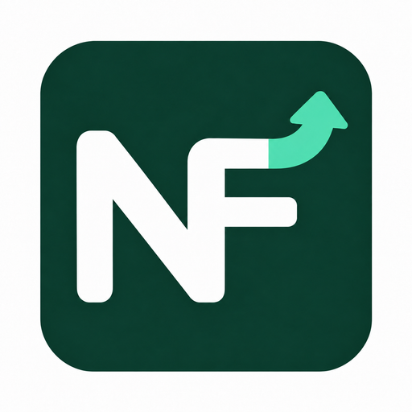

<p align="center"></p>
<h1 align="center">NameFirst</h1>
<p align="center"><strong>Pesquise um nome. Encontre primeiro o site oficial.</strong></p>

[简体中文](./README.md) · [English](./README.en.md) · [繁體中文](./README.zh-TW.md) · [日本語](./README.ja.md) · [한국어](./README.ko.md) · [Español](./README.es.md) · [Français](./README.fr.md) · [Deutsch](./README.de.md) · [Português (Brasil)](./README.pt-BR.md)

NameFirst é uma extensão para Chrome e Microsoft Edge no computador. Ao pesquisar no Baidu ou Bing o nome de uma plataforma presente no catálogo, ela exibe um cartão claramente identificado com o acesso oficial no início da área de resultados da Web. Você também pode salvar sites pessoais e recuperá-los localmente.

**Este guia corresponde à versão 1.1.0: 118 entidades e 173 entradas oficiais, com 68 novas plataformas e ferramentas comuns entre universitários, incluindo Canva 可画.** Consulte [Releases](https://github.com/Thicky-han/namefirst/releases) para saber quais versões já foram publicadas e estão disponíveis.

Você não precisa de conta do NameFirst, chave de API nem compilar o código. O catálogo e as memórias pessoais são processados localmente; pesquisar e visitar sites requer internet. O projeto usa uma licença não comercial com código-fonte disponível, resumida abaixo.

**A tradução do guia não altera o idioma da interface.** A extensão está principalmente em chinês simplificado; incluímos os rótulos chineses reais para facilitar a identificação. Nomes e aliases não são traduzidos automaticamente: use os exemplos exatamente como aparecem. Todos os idiomas usam os mesmos pacotes, sem ampliar a compatibilidade com buscadores ou regiões. Outros documentos vinculados podem estar em chinês.

## Etapa 1: Baixe o pacote do seu navegador

**Para uma instalação comum, basta um dos ZIPs abaixo.** Se você usa os dois navegadores, baixe e instale cada pacote separadamente.

| Navegador | Arquivo | Download |
| --- | --- | --- |
| Google Chrome | `namefirst-chrome-1.1.0.zip` | [Para Chrome](https://github.com/Thicky-han/namefirst/releases/download/v1.1.0/namefirst-chrome-1.1.0.zip) |
| Microsoft Edge | `namefirst-edge-1.1.0.zip` | [Para Edge](https://github.com/Thicky-han/namefirst/releases/download/v1.1.0/namefirst-edge-1.1.0.zip) |

Para localizar os arquivos manualmente:

1. Abra [NameFirst Releases](https://github.com/Thicky-han/namefirst/releases).
2. Abra a versão publicada marcada como **Latest**. Se a 1.1.0 ainda não aparecer, use a versão de fato publicada e seus nomes de arquivo.
3. Role até **Assets** e expanda a lista pela pequena seta, se necessário.
4. Clique em `namefirst-chrome-VERSÃO.zip` ou `namefirst-edge-VERSÃO.zip` para seu navegador e aguarde a conclusão.

Estes arquivos não são necessários para a instalação comum:

| Arquivo | Finalidade |
| --- | --- |
| `namefirst-source-1.1.0.zip` | Código completo e modificável e materiais de compilação para desenvolvedores |
| `Source code (zip)` / `Source code (tar.gz)` | Cópias do código geradas pelo GitHub; não podem ser carregadas diretamente como extensão pronta |
| `release-manifest.json`, `SHA256SUMS.txt` | Verificação de versão, origem e integridade |

O botão verde **Code → Download ZIP** também baixa código-fonte. Para instalar, use o ZIP específico do navegador.

## Etapa 2: Extraia tudo e encontre a pasta extension

1. Localize o ZIP no gerenciador de arquivos, normalmente em Downloads.
2. Clique com o botão direito e selecione **Extrair tudo** ou o recurso equivalente do sistema. Abrir o ZIP para ver os arquivos não é suficiente.
3. Mantenha a pasta extraída em um local permanente. O navegador continuará lendo os arquivos após a instalação; não os apague nem os mova sem cuidado.
4. Dentro da pasta extraída, encontre **`extension`**.

Os dois pacotes têm a mesma estrutura:

```text
namefirst-chrome-1.1.0/
├─ extension/                 ← Selecione esta pasta na próxima etapa
│  ├─ manifest.json
│  ├─ icons/
│  ├─ pages/
│  └─ scripts/
├─ INSTALL.md
├─ PRIVACY.md
└─ ...
```

**Selecione a pasta que contém diretamente `manifest.json`.** Não selecione o ZIP, a pasta externa, `scripts` nem o próprio arquivo manifest.

## Etapa 3: Carregue o NameFirst no navegador

### Chrome

1. Abra uma nova aba no Chrome.
2. Digite `chrome://extensions` na **barra de endereços do navegador** e pressione Enter, não na caixa de pesquisa do buscador.
3. Ative o **Modo do desenvolvedor (Developer mode)**.
4. Clique em **Carregar sem compactação (Load unpacked)** ou no botão equivalente.
5. Selecione a pasta **`extension`** extraída e confirme.
6. Verifique o cartão **NameFirst**, com NF verde-escuro e seta verde-clara: versão **1.1.0** e ativado.

### Microsoft Edge

1. Abra uma nova aba, digite `edge://extensions` na barra de endereços e pressione Enter.
2. Ative o **Modo de desenvolvedor (Developer mode)**, que pode estar no menu lateral.
3. Clique em **Carregar sem pacote (Load unpacked)** ou no botão equivalente.
4. Selecione a pasta **`extension`** extraída e confirme.
5. Verifique se **NameFirst 1.1.0** aparece e está ativado.

Mantenha o modo de desenvolvedor ligado e preserve os arquivos. Nas atualizações, recarregue o cartão existente do NameFirst. Esta versão não está nas lojas de extensões do Chrome/Edge. Consulte também as instruções oficiais do [Chrome](https://developer.chrome.com/docs/extensions/get-started/tutorial/hello-world) e do [Edge](https://learn.microsoft.com/en-us/microsoft-edge/extensions/getting-started/extension-sideloading).

## Etapa 4: Faça uma pesquisa de teste

1. Atualize as abas do Baidu/Bing que já estavam abertas.
2. Abra [Baidu](https://www.baidu.com/) ou [Bing](https://www.bing.com/) e use a pesquisa **Web** comum.
3. Pesquise um destes exemplos exatamente como está. Preserve os caracteres chineses: `下载` significa “download”.

| Consulta | Entrada esperada |
| --- | --- |
| `Steam` | Loja oficial do Steam |
| `可画` / `Canva可画` | Site oficial do Canva 可画 para a China continental |
| `可画下载` | Download oficial do Canva 可画 para Windows |
| `Zotero下载` | Download oficial do Zotero |
| `腾讯会议下载` | Central oficial de downloads do Tencent Meeting |
| `RStudio下载` | Download oficial do RStudio Desktop da Posit |

4. Encontre **“NameFirst · 已核实官方入口”** (“entrada oficial verificada”) no início do contêiner de resultados da Web. Não há garantia de ficar acima de anúncios ou módulos de IA em outras áreas.
5. Clique no nome do site ou em links adicionais, como **“官方下载页面”** (“página oficial de download”).

Os resultados e anúncios originais permanecem. A extensão não redireciona automaticamente nem altera a classificação no servidor do buscador. `Rust` apresenta a linguagem de programação e o jogo como opções. Consultas informativas como `Steam 使用教程` normalmente seguem como pesquisa comum.

## Etapa 5: Fixe o ícone e gerencie seus sites

1. Abra o menu **Extensões**, geralmente com formato de peça de quebra-cabeça.
2. Encontre o NameFirst e fixe o ícone ou exiba-o na barra de ferramentas.
3. Pelo ícone, acesse a chave geral, as chaves de Baidu/Bing e a da opção de feedback.
4. Clique em **“管理个人记录与备份”** (“gerenciar registros e backups pessoais”) para adicionar, editar, excluir, pesquisar e importar/exportar JSON.

Para um site não listado, abra **“选择并记住个人目标”** em uma página compatível, confira nome, aliases e endereço HTTPS e clique em **“保存个人目标”**. Pesquisas pelo nome ou alias salvo poderão mostrar **“个人记忆”** (“memória pessoal”). Salvar um destino não certifica sua identidade oficial.

São até 500 destinos e 10 aliases por destino. Os backups não são criptografados e têm limite de 4.000.000 bytes; guarde-os com segurança. Chrome e Edge não sincronizam automaticamente. Exporte, importe no outro navegador e confira a prévia. A importação mescla por padrão; substituir ou limpar exige confirmação. A última alteração de memória pode ser desfeita.

## Atualize uma instalação anterior para 1.1.0

Extensões carregadas sem empacotamento não são atualizadas automaticamente pelo GitHub:

1. Na versão antiga, abra **“管理个人记录与备份”**, exporte o backup, salve edições pendentes e feche a página de gerenciamento.
2. Baixe o novo ZIP e extraia tudo para outra pasta.
3. Localize a **pasta `extension` antiga** usada na instalação e mantenha o caminho.
4. Copie **todo o conteúdo interno** da nova `extension` para a antiga, substituindo arquivos com o mesmo nome. Não crie `extension/extension/manifest.json`.
5. Em `chrome://extensions` ou `edge://extensions`, clique em **Recarregar** ou na seta circular do cartão **existente** do NameFirst.
6. Confirme **1.1.0**, atualize as pesquisas e confira se os registros pessoais continuam presentes.

Não desinstale a versão antiga antes. O ID estável é `kocncgipjlmfdlhabchnbnjgahlpfjkc`; substituir os arquivos no mesmo local e recarregar preserva a identidade. Desinstalar, limpar o perfil ou mudar a identidade pode causar perda dos dados locais. Use JSON ao mudar de computador ou perfil.

## Problemas comuns

| Problema | O que verificar |
| --- | --- |
| Não encontro os arquivos | Abra os detalhes da versão e expanda Assets; não procure instaladores na lista de código |
| Manifest ausente / falha ao carregar | Extraia tudo e escolha a pasta que contém diretamente `manifest.json`; use o ZIP do navegador, não o código-fonte |
| Ícone ausente | Fixe-o no menu Extensões |
| Cartão não aparece | Atualize, confira as chaves e teste `Steam` na pesquisa Web; CAPTCHA, imagens, notícias, vídeos e páginas independentes de IA estão fora do escopo |
| Ferramenta não aparece | Apenas nomes, aliases e subentradas cadastrados correspondem; veja [CATALOG.md](./CATALOG.md) ou salve um destino pessoal |
| Falta um download | Páginas de download precisam de verificação separada; cadastrar um fabricante não inclui todos os produtos nem permite adivinhar URLs de instaladores |
| Ainda aparece a versão antiga | Substitua na pasta original e recarregue o cartão existente e as pesquisas |
| Modo de desenvolvedor indisponível | Em navegador gerenciado por escola ou empresa, consulte o administrador |
| Site não abre / exige login | Ser oficial não garante acesso em toda região, dispensa de conta ou gratuidade; siga as condições do site |

Para mais ajuda, abra uma [Issue](https://github.com/Thicky-han/namefirst/issues) com versões, buscador e passos de reprodução. Não publique backups pessoais, credenciais ou páginas sensíveis. Baixar e usar não exige conta GitHub; enviar Issues/PRs segue os requisitos de conta do GitHub.

## Escopo e privacidade

As 68 adições abrangem ensino, serviços estudantis, pesquisa acadêmica, escrita, colaboração, análise de dados, engenharia, criação, IA, tradução, navegadores e utilitários. São **118 entidades e 173 entradas**, separando sites, lojas, downloads e documentação. Fontes em [CATALOG.md](./CATALOG.md).

“Verificada” significa conferida com páginas oficiais ou links oficiais explícitos na preparação do catálogo. **Não é certificação em tempo real a cada pesquisa nem certificação de segurança do software.** Não há rastreamento de sites em segundo plano, download de atualizações do catálogo, treinamento on-line, envio de feedback pessoal ou coleta de todo o histórico de pesquisas. A validade é de 180 dias; depois é necessária nova revisão pelo mantenedor e nova versão. Confirmação pessoal não renova datas oficiais.

Funciona apenas nas páginas de pesquisa Baidu/Bing de desktop compatíveis. Os registros ficam no perfil atual. Não precisa de conta do projeto, servidor do desenvolvedor, API paga nem treinamento na nuvem. Os sites de destino mantêm exigências de login, assinatura ou licença universitária. Veja [PRIVACY.md](./PRIVACY.md).

Os testes foram feitos no Chrome/Edge de desktop no Windows, sem verificar individualmente outros sistemas, todas as versões históricas ou todos os experimentos regionais. Testes controlados e relatos manuais reais são diferenciados em [VERIFICATION.md](./VERIFICATION.md) e [PRE_RELEASE_CHECK.md](./PRE_RELEASE_CHECK.md).

## Licença, contribuições e origem

O trabalho original usa **NameFirst Noncommercial Reciprocal License 1.0**. Permite uso, modificação e distribuição gratuitos, incluindo uso interno gratuito em empresas. Vendas, serviços pagos, publicidade e outras monetizações exigem autorização separada. A distribuição exige acesso público gratuito ao código correspondente e aos materiais de compilação necessários; alterações abrangidas mantêm a mesma licença. Modificações locais privadas não precisam ser publicadas.

É um projeto **não comercial com código-fonte disponível**, não uma licença de código aberto segundo a OSI. Este texto é um resumo; prevalece a [LICENSE](./LICENSE) formal. Veja [LICENSE_SCOPE.md](./LICENSE_SCOPE.md). Instalação e uso normais não exigem assinar CLA.

Contribuições originais seguem [CONTRIBUTING.md](./CONTRIBUTING.md) e um [CLA](./CLA.md) aceito separadamente. Contribuidores mantêm os direitos autorais e podem conceder uso comercial, distribuição de código fechado e sublicenciamento a um destinatário identificado em particular. A conta pública é `Thicky-han`; identidades legais e acordos assinados são privados. Contribuições não assinadas, código de origem do projeto-base e terceiros não são incluídos automaticamente. Veja [CLA_GUIDE.md](./CLA_GUIDE.md).

Este repositório é um fork real de [uBlacklist](https://github.com/iorate/ublacklist), fixado em `v10.1.2` / `212384b330002a4c727b034806826e2eb352d7d5`. O código do projeto-base está em `extension/`; builtin está fixado em `c8bd5b7113dc1d416fa00c45509ac308619751df` e incluído como arquivos comuns. main preserva a ancestralidade real do projeto-base.

MIT do projeto-base, licenças de terceiros e atribuições são preservadas. O pacote inteiro não deve ser descrito como MIT. Incluem-se licença pública, `UPSTREAM-LICENSE.txt`, origem e avisos de dependências. Veja [MODIFICATIONS.md](./MODIFICATIONS.md), [NOTICE](./NOTICE) e [UPSTREAM.json](./UPSTREAM.json).

<details>
<summary>Desenvolvedores: compilar e verificar o código</summary>

Para uso comum, basta o ZIP do navegador. Desenvolver exige PowerShell 7, Node.js e pnpm. Na raiz do projeto:

```powershell
./scripts/Build.ps1 -InstallDependencies
./scripts/Package.ps1
./scripts/Verify-Package.ps1
./scripts/Audit-Runtime.ps1
node scripts/check-public-content.mjs
node scripts/check-release-content.mjs
```

Gere pacotes formais a partir de `main` local com alterações já commitadas. Em `extension/`:

```powershell
$env:CI = 'true'
$env:LEFTHOOK = '0'
pnpm check
pnpm test
pnpm exec playwright test --config e2e/namefirst/playwright.config.ts
```

devEngines do projeto-base especifica Node 26.10.0; ferramentas locais usam Node 24 do host e pnpm 11. O modo separado `--namefirst` preserva o modo padrão do projeto-base. Não altere a chave pública estável nem trate uma compilação padrão do projeto-base como NameFirst.

Os testes usam perfis temporários separados. Dependências, caches, relatórios gerados e perfis não são commitados nem empacotados. A análise estática não garante detectar todos os segredos desconhecidos. Manutenção e publicação: [PUBLISHING.md](./PUBLISHING.md).

</details>

Mais documentos: [Instalação](./INSTALL.md) · [Catálogo](./CATALOG.md) · [Notas da versão](./RELEASE_NOTES.md) · [Verificação](./VERIFICATION.md) · [Especificação](./PROJECT_SPEC.md) · [Plano](./IMPLEMENTATION_PLAN.md). Relatórios históricos descrevem a época correspondente; Releases mostra a publicação atual.
